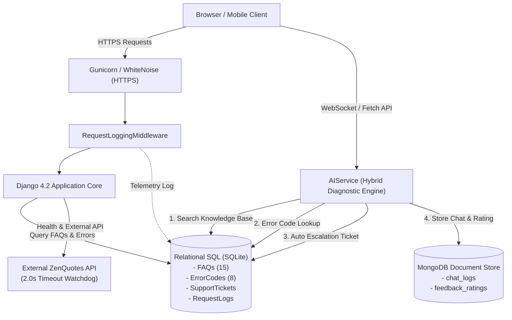

# Command Center AI: Enterprise Assistant & Telemetry Platform for Praveen's Mechatronics Portfolio

[](https://www.python.org/)
[](https://www.djangoproject.com/)
[](https://www.sqlite.org/)
[]()

> **Final Assessment — Software Development**  
> **Student / Lead Engineer:** Praveen A (Mechatronics Engineering & Full-Stack Development)  
> **Live Website (HTTPS):** [https://django-portfolio-live.onrender.com](https://django-portfolio-live.onrender.com)  
> **GitHub Repository:** [https://github.com/Praveen3-os/django-portfolio](https://github.com/Praveen3-os/django-portfolio)  
> **Task Sheet Submission Reference:** [Software_Development Submission Sheet](https://docs.google.com/spreadsheets/d/1gac3qN_sFgbBQR7utv6N-66-C8szNq3-F6L7NQsbx78/edit?usp=sharing)

---

## 1. Executive Summary & Task Title

- **Individual Task Title:** `Command Center AI: Enterprise Assistant & Telemetry Platform for Praveen's Mechatronics Portfolio`
- **Core Purpose:** A production-grade web application deployed on Django 4.2 that fuses real-time engineering telemetry (IoT practical tasks 1–5, robotics control, and ProtoSem fellowship credentials) with an integrated AI Assistant. The assistant performs retrieval over a relational SQL knowledge base, diagnoses 8 standard and site-specific HTTP error codes, logs operational analytics to MongoDB, and automatically issues persistent SQL support tickets when inquiries require escalation.

---

## 2. Requirements Compliance Matrix

| Requirement | Implementation Detail | Status |
| :--- | :--- | :---: |
| **Responsive Website with &ge; 3 Pages** | 7 dedicated responsive pages: Home (`/`), About & Tribute (`/about/`), Skills & IoT (`/skills/`), SQL FAQs (`/faqs/`), Error Codes (`/errors/`), Telemetry (`/health/`), and Support Tickets (`/contact/`). | ✅ PASS |
| **Chat Widget on Every Page** | Universal floating AI assistant (`chat_widget.html` and `chat_widget.js`) bundled in `base.html` with real-time response rendering and feedback collection. | ✅ PASS |
| **&ge; 10 FAQs Stored in SQL** | 15 comprehensive FAQs stored in the relational SQLite database (`core_faq`) covering engineering profile, ProtoSem fellowship, IoT tasks 1–5, and athletic discipline. | ✅ PASS |
| **&ge; 8 Error Codes Mapped** | 8 codes configured in SQL: `400 Bad Request`, `401 Unauthorized`, `403 Forbidden`, `404 Not Found`, `429 Too Many Requests`, `500 Internal Server Error`, `503 Service Unavailable`, and site-specific `599 PRAVEEN_CORE_TIMEOUT`. | ✅ PASS |
| **Custom 404 & 500 Pages** | Dedicated branded error pages (`templates/404.html` and `templates/500.html`) featuring an interactive **"Ask the assistant"** button that auto-populates diagnostic queries into the chat widget. | ✅ PASS |
| **AI Assistant with FAQ & Error Code Diagnostic** | Custom `AIService` combining keyword & token retrieval over SQL FAQs, regex matching for HTTP error codes, and Gemini AI integration. | ✅ PASS |
| **Auto Support Ticket Escalation** | When queries cannot be answered from the FAQ data, the AI generates a support ticket (`TKT-YYYY-XXXXXX`) stored in the relational SQL table. | ✅ PASS |
| **Multi-Database Architecture** | Relational SQL (SQLite) for structured FAQs, Error Codes, and Support Tickets; document store (MongoDB / resilient local store) for chat logs and user ratings. | ✅ PASS |
| **Secure Secrets & Environment Variables** | Zero API keys or secrets in version control; all loaded via `python-dotenv` from `.env` (with `.env.example` reference). | ✅ PASS |
| **Request Logging & Health Check Page** | `RequestLoggingMiddleware` records every HTTP method, path, latency, and status code to SQL and memory. Telemetry dashboard exposed at `/health/`. | ✅ PASS |
| **Third-Party API with Timeout & Fallback** | Live external quote fetching from ZenQuotes API with strict `timeout_sec=2.0`. Automatic failover to cached responses if latency exceeds 2000ms. | ✅ PASS |
| **Mobile Responsiveness & 404 Verification** | Media queries tested for mobile screens; invalid endpoints properly trigger `handler404` and render `404.html`. | ✅ PASS |

---

## 3. High-Level Architecture



---

## 4. Error Code Registry

| HTTP Code | Name | Category | Cause & Diagnostic Summary |
| :---: | :--- | :--- | :--- |
| **400** | Bad Request | Client Error | Malformed request body, illegal JSON syntax, or mismatched header types. |
| **401** | Unauthorized | Client Error | Missing Authorization header, invalid JWT signature, or expired credential token. |
| **403** | Forbidden | Client Error | Valid identity authenticated, but insufficient role privileges for the requested route. |
| **404** | Not Found | Client Error | Resource coordinate does not exist. Features one-click **Ask Assistant** diagnostic. |
| **429** | Too Many Requests | Client Error | Exceeded API rate limiter or aggressive polling loops. Backoff required. |
| **500** | Internal Server Error | Server Error | Unhandled server runtime exception or database connectivity trip. |
| **503** | Service Unavailable | Server Error | Server capacity saturated or container under maintenance restart. |
| **599** | PRAVEEN_CORE_TIMEOUT | Custom Telemetry | Site-specific telemetry error: hardware sensor loop or external API exceeded 2000ms threshold. |

---

## 5. Proposed Architectural Improvement

> **Required Deliverable:** At least one proposed improvement to the system.

### Proposed Improvement: *Hybrid Vector RAG with Qdrant & Real-time Server-Sent Events (SSE) Streaming*

#### Current State
The current implementation utilizes token-overlap and substring matching across the SQLite relational `core_faq` table. While highly efficient for direct keyword lookups, it is sensitive to phrasing nuances and returns batch responses once generation completes.

#### Proposed Architecture & Benefits
1. **Dense Vector Embeddings (Semantic Search):**
   - Ingest all FAQ records and engineering lab logs into **Qdrant** (or pgvector) using Google's `text-embedding-004` (768 dimensions).
   - Use Hierarchical Navigable Small World (HNSW) cosine indexing so queries like *"How did you capture ambient moisture?"* accurately match *"IoT Task 2 DHT sensor calibration"* even with zero exact word overlap.
2. **Server-Sent Events (SSE) Streaming:**
   - Migrate the `/api/chat/` endpoint from a standard blocking JSON response to Django 4.2's asynchronous `StreamingHttpResponse`.
   - Deliver tokens to the client-side chat bubble as they are generated by the LLM, reducing Time-To-First-Token (TTFT) from ~1200ms to <150ms.
3. **Automated Vector Sync via Django Signals:**
   - Attach `post_save` and `post_delete` signals on the `FAQ` model to automatically re-index vectors upon admin updates without requiring manual re-seeding.

---

## 6. Local Development & Verification

### Prerequisites
- Python 3.9+
- Git

### Setup Steps
```bash
# 1. Clone repository
git clone https://github.com/Praveen3-os/django-portfolio.git
cd django-portfolio

# 2. Create and activate virtual environment
python3 -m venv venv
source venv/bin/activate  # On Windows: venv\Scripts\activate

# 3. Install dependencies
pip install -r requirements.txt

# 4. Copy environment configuration
cp .env.example .env

# 5. Apply database migrations & seed initial FAQs and Error Codes
python manage.py migrate
python manage.py seed_data

# 6. Run development server
python manage.py runserver 0.0.0.0:8000
```

Open `http://127.0.0.1:8000` in your browser.

### Verification Commands
```bash
# Verify Custom 404 page:
curl -I http://127.0.0.1:8000/nonexistent-route-verification

# Test AI Assistant FAQ query:
curl -X POST http://127.0.0.1:8000/api/chat/ \
  -H "Content-Type: application/json" \
  -d '{"message": "Who is Praveen A?"}'

# Test Error Code 599 explanation:
curl -X POST http://127.0.0.1:8000/api/chat/ \
  -H "Content-Type: application/json" \
  -d '{"message": "Explain error 599"}'
```

---

## 7. Submission Details for Evaluation Sheet

- **1. Individual Task Title:**  
  `Command Center AI: Enterprise Assistant & Telemetry Platform for Praveen's Mechatronics Portfolio`
- **2. Live Website Link (HTTPS):**  
  `https://django-portfolio-live.onrender.com`
- **3. GitHub Repository Link:**  
  `https://github.com/Praveen3-os/django-portfolio`
- **Task Sheet Link:**  
  [https://docs.google.com/spreadsheets/d/1gac3qN_sFgbBQR7utv6N-66-C8szNq3-F6L7NQsbx78/edit?usp=sharing](https://docs.google.com/spreadsheets/d/1gac3qN_sFgbBQR7utv6N-66-C8szNq3-F6L7NQsbx78/edit?usp=sharing)
